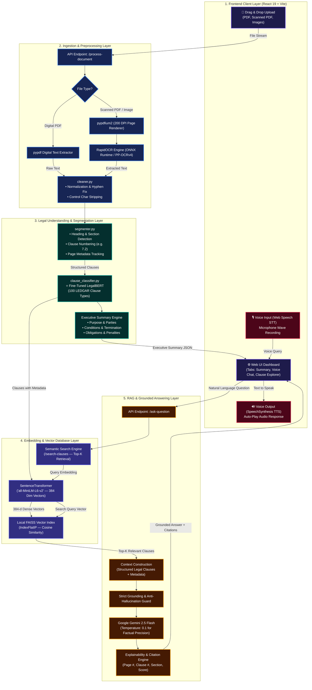

# 🏛️ VOXLEGAL AI — FINAL MASTER SYSTEM ARCHITECTURE

## 1. Master System Architecture Diagram

---

## 2. Component Responsibility Matrix

| Layer | Technology | Primary Function | Research & Practical Value |
|---|---|---|---|
| **Frontend** | React 19, Vite, Vanilla CSS Design System | UI Dashboard, Multi-Tab Views, Voice Interface | User interaction & accessibility |
| **Ingestion** | `pypdf`, `pypdfium2`, `RapidOCR` | Dual-mode digital PDF and scanned image text extraction | Robust ingestion across all document formats |
| **Text Processing** | Custom `cleaner.py` & `segmenter.py` | Normalizes whitespace, fixes line wraps, detects clause structure | Preserves clause-level integrity and page traceability |
| **Legal Domain AI** | `nlpaueb/legal-bert-base-uncased` (LEDGAR) | Classifies clause categories (Termination, Confidentiality, etc.) | **Domain-Specific Adaptation (RQ2)** |
| **Embeddings** | `sentence-transformers/all-MiniLM-L6-v2` | Computes 384-dimensional dense vector embeddings (100% local) | Fast, local, free mathematical vectorization |
| **Vector DB** | `faiss-cpu` (`IndexFlatIP`) | Local in-memory Cosine Similarity index | Efficient semantic similarity matching |
| **RAG & Grounding** | `rag_engine.py` + Gemini 2.5 Flash | Constructs context, verifies factual grounding, generates answers | **Hallucination reduction & Explainability (RQ1, RQ3, RQ4)** |
| **Voice Layer** | Browser `SpeechRecognition` & `SpeechSynthesis` | Voice input STT and auto-speech playback TTS | **Voice-driven legal QA usability (RQ5)** |
